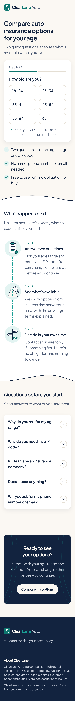
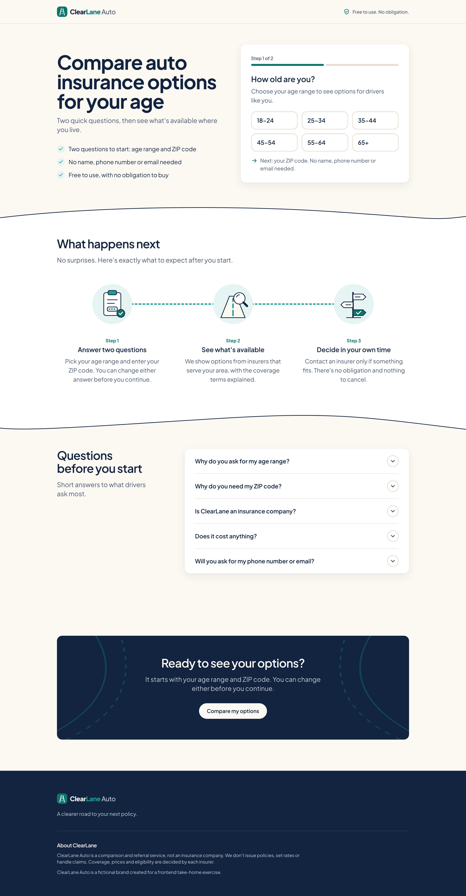

# ClearLane Auto: Frontend take-home

Three connected pages for ClearLane Auto, a fictional auto insurance comparison and referral service.

Live preview: not deployed (optional in the brief). Run it locally with the steps below.

Design file: [ClearLane Auto: components](https://claude.ai/artifact/EiQHuKCV1dWSzBp4C2z9m8?sk=OAXNDsqbSXv2-tQEOUpIKw#page-dcb81aee8d83). Every component and state, plus all three pages at 375px and 1440px, rendered from this code.

## Run it

```bash
npm install
npm run dev
```

Open http://localhost:3000

Requires Node.js 20.9 or newer (Next.js 16's minimum).

## Routes

- **Homepage:** `/`
- **Campaign landing page:** `/compare`
- **Blog article:** `/blog/what-affects-your-car-insurance-rate`

## Testing the funnel

- Attribution: `/compare?utm_source=fb&utm_campaign=age_test&click_id=abc123`
- Trigger the mock error: add `&mock=fail` to the URL (first attempt fails, "Try again" succeeds) or `&mock=fail-always`
- Skip step 1 from the homepage: `/compare?age=45-54` opens on the ZIP step (the homepage hero's age buttons link here)
- Events: open the browser console. The brief's two events are `age_selected` and `comparison_started` (success only). Three more show where people drop off: `zip_step_viewed`, `zip_invalid` and `submit_failed`. No event includes the age or ZIP; the submission payload does.
- Browser Back: on the ZIP step, Back returns to the age step with the age still selected
- Attribution cookie: arriving with any campaign param saves them for 30 days in a first-party cookie, `cl_attribution` (set in `src/proxy.ts`). If a later visit has no params in the URL, events and the payload use the cookie instead. The URL always wins, and a new ad click replaces the cookie. To test: open `/?utm_source=fb&utm_campaign=age_test&click_id=abc123`, then open `/compare` with no params and pick an age. To reset: delete the cookie in DevTools (Application → Cookies).

## Project structure

```
src/app/(site)/        Homepage + article, full site header
src/app/(campaign)/    Paid landing page, minimal header
src/components/        Shared UI (CompareLink, Faq, StepList, ArticleCard, ...)
src/lib/site.ts        Routes, nav links, CTA label, disclosure (one place)
src/lib/content/       Page copy as typed data (FAQ, steps, coverage, articles)
src/lib/               Attribution, analytics, mock submission
src/proxy.ts           Saves campaign params in the cl_attribution cookie
```

## Task 1: Conversion hypothesis

**Primary metric:** successful comparison starts (`comparison_started`) ÷ campaign landing-page visits.

The visitor clicked an ad that says _"Compare auto insurance options for your age."_ Each change below removes one reason they might leave before starting a comparison.

**1. The page repeats the ad and starts with the question.**

- **Change:** the H1 is the ad's own line, and the age picker sits in the hero, above the fold at 375px. Six non-overlapping ranges are big one-tap buttons.
- **Friction it addresses:** message mismatch ("did I land in the right place?") and scrolling to find where to start, especially on phones.
- **Expected effect:** more visitors pick an age, so `age_selected` ÷ visits goes up.

**2. Only two questions, and the page says so before you commit.**

- **Change:** age, then ZIP. "No name, phone number or email needed" sits next to the form, "What happens next" explains the three steps, and "ClearLane is a comparison and referral service, not an insurer" sits under the button.
- **Friction it addresses:** fear of a long form, sales calls and spam, and not knowing what happens after clicking.
- **Expected effect:** more people who pick an age go on to submit, so `comparison_started` ÷ `age_selected` goes up.

**3. Mistakes and failures never cost the visitor their answers.**

- **Change:** ZIP errors say how to fix them ("Enter a 5-digit ZIP code, like 02134") and leading zeros are kept. "Change" goes back with the age still selected, a failed request keeps both answers and offers "Try again", and the button can't be double-clicked.
- **Friction it addresses:** retyping after an error, confusing validation, and duplicate or broken submissions.
- **Expected effect:** fewer people leave after a `zip_invalid` or `submit_failed`, and more failed submissions are recovered.

**How I'd test it:** an A/B test on the same ad and audience, with visitors randomly split 50/50 between the current page and this variant (sticky per visitor via a cookie, and the variant recorded with every event).

- Decide the sample size up front from the current conversion rate and the smallest lift worth detecting, and run at least two full weeks so every weekday is covered.
- Don't stop early because one side looks ahead.
- Read the funnel events (`age_selected` → `zip_step_viewed` → `zip_invalid` / `submit_failed` → `comparison_started`) to see _which_ change did the work, and check the result holds on mobile and desktop separately.

**Downstream quality metric:** the share of comparison starts where the visitor goes on to choose at least one insurer to hear from (a referral) within 7 days. A page can raise starts by attracting low-intent clicks; this makes sure the extra starts are real.

## Task 2: Reference choices

**Idea 1, from Lemonade: explain coverage as everyday situations, not policy terms.** Lemonade's car page lists coverage as "If you're in a car crash", "If your car is stolen". ClearLane's coverage explorer does the same: each example leads with situations it helps with and situations it doesn't ("You slide on ice into a guardrail", "A tree branch falls on your parked car"), each with a small drawing, and only then names and defines the terms. **Why it suits drivers 35–65:** they shop because they want a better rate, not because they know the jargon. A situation they can picture makes the difference between options obvious without a glossary.

**Idea 2, from Corgi: a warm ground, one color reserved for action, and plain "not the insurer" language.** Corgi uses a warm off-white page, saves one bright color for its main buttons, and says in plain words that it acts "not as the insurer." ClearLane uses cream, keeps teal-strong for things you can tap, and puts "ClearLane is a comparison and referral service, not an insurer" right under the form button, as well as in the FAQ and footer. **Why it suits this audience:** warmth reads as approachable rather than corporate, one action color tells people exactly where to tap, and saying what we _aren't_, where people decide, builds trust with a skeptical shopper faster than big claims would.

What I didn't take: both sites' main buttons fail text contrast (white on bright pink or orange, 3.8:1 and 3.1:1); ClearLane's white on teal-strong is 5.5:1. 

**How the homepage and the landing page serve different visitors**

**Campaign landing page (`/compare`)**

- **Who arrives:** someone who clicked an ad and already wants to compare.
- **Their question:** "Is this the right place, and how fast can I start?"
- **Layout:** the form is the hero. The header is the wordmark only, with no navigation, so there's no exit from the task.
- **Content:** only what supports starting: what happens next, and FAQs about the form (why age, why ZIP, will you call me).
- **Calls to action:** one action, answering the next question. The final band scrolls back to the form.

**Homepage (`/`)**

- **Who arrives:** someone who doesn't know ClearLane yet.
- **Their question:** "What is this, can I trust it, and what would I get?"
- **Layout:** full navigation, an explanation first, then room to explore at your own pace.
- **Content:** how it works, the coverage explorer, why compare, guides and broader FAQs.
- **Calls to action:** "Compare my options" is always available (hero, mid-page, final band, sticky on phones) but never forced.

## Design decisions

- **Brand tokens in one place.** Colors, card radius, shadows and animations live in `@theme` in `src/app/globals.css`. Heading and paragraph defaults are set by element, so pages don't repeat type classes. Every text color pair passes WCAG AA.
- **The road as the visual identity.** It matches the promise "A clearer road to your next policy":
  - The hero is a full-width road landscape.
  - Sections meet at hill-shaped edges (`HillDivider`), and a dashed lane joins the steps (`StepList`).
  - Twelve illustrations share one hand-drawn style: the hero, nine spot drawings (`Spot.tsx`) and the article art.
  - The hero is capped at its drawn size, with a wider version for very large screens, so it never blows up.
- **One typeface, calm weights.** Plus Jakarta Sans throughout, with H1 at 700 and H2 at 600, so headings read as a calm explanation rather than a sales pitch. Body text is 18px at every width for a 35–65 audience.
- **Motion that confirms, never performs.** Sections fade up as you scroll, the steps' lane draws itself, the hero's lane dashes roll and clouds drift, funnel steps slide in, and the success check draws.
  - It's all CSS with no JavaScript (scroll-driven animations, plus animation inside the hero SVG).
  - All of it is off for people who ask for reduced motion.
  - Browsers without support show the page fully visible and still.
- **Funnel state.** A reducer keeps the _answers_ separate from the _screen_, so an error never wipes what the visitor entered. A `useRef` lock blocks double submits. The ages are buttons rather than radios, so one tap moves on, and arrow keys don't jump people forward by accident. The coverage explorer _does_ use radios, because there you want arrow keys to switch examples.
- **Attribution.** Campaign params are read from the URL and carried on every internal link (`AttributedLink`, `CompareLink`). They are also saved in a 30-day first-party cookie (`src/proxy.ts`, last click wins), so a visitor who comes back without the params is still credited. Events and the payload get them from `currentAttribution()`.
- **Analytics.** A typed `track()` with a fixed list of event names logs to the console. Events carry only the page and campaign params, never the age or ZIP. Only the mock submission payload contains the answers.
- **Swappable pieces.** Page copy lives in `src/lib/content/` as typed data, routes and the CTA label in `src/lib/site.ts`, and the request in `submitComparison()`. A CMS, a real API or a real analytics provider each replaces one file, not the pages.
- **Beyond the brief, on purpose:**
  - The homepage hero's "Start with your age range" buttons open `/compare?age=…` on the ZIP step, one step shorter for visitors who already know they want to compare.
  - A sticky "Compare my options" bar on phones, adapted from Lemonade. It hides whenever another compare button, the form or the footer is on screen.
  - Three drop-off events: `zip_step_viewed`, `zip_invalid`, `submit_failed`.
- **Design file:** every component, funnel state and page is in the [design canvas](https://claude.ai/artifact/EiQHuKCV1dWSzBp4C2z9m8). The style guide is in `docs/style-guide.md` and `docs/style-guide.pdf`.

## Verification notes

Checked on November 24, 2026, with a production build (`npm run build && npm start`) in Chromium. I used scripted Playwright checks, an axe-core accessibility scan, and a manual pass by keyboard.

Every check passed on all three pages at both 375px and 1440px.

- **No horizontal scroll** on any page at either width.
- **Accessibility scan:** axe (WCAG 2.1 A/AA plus best practices) found 0 issues.
- **Headings and metadata:** one H1 per page, no skipped heading levels, and a unique `<title>` and meta description on each page.
- **Keyboard navigation:** about 57 tab stops per page. "Skip to main content" comes first, and every stop has a visible focus ring.
- **Mobile menu (375px):** Enter opens it (`aria-expanded` updates), Escape closes it and returns focus to the button, and its links reach all three pages.
- **Form labels and errors:** the ZIP field has a visible label. Errors set `aria-invalid`, are linked with `aria-describedby`, and focus moves to the field.
- **Navigation links:** every internal link returns 200.
- **Image sizing:** every image has `alt` plus `width` and `height`, so nothing shifts or stretches.
- **Attribution:** `utm_source`, `utm_campaign` and `click_id` carry through the nav, the mobile menu, every compare link, the article CTA and the submission payload.
- **Events:** `age_selected` fires on picking an age. `comparison_started` fires only after a successful submit, never on a validation error or failed request. No event includes the age or ZIP, and nothing fires on page load.

**Manual funnel test** (`/compare?utm_source=fb&utm_campaign=age_test&click_id=abc123&mock=fail`, console open):

1. Keyboard only: pick an age, and focus lands in the ZIP field.
2. "Change": the previous age is still selected.
3. Submit empty, then `1234`, then `0213a`: each shows a clear error, and no `comparison_started` fires.
4. Submit `02134`: the first attempt fails and the answers stay. "Try again" succeeds, and one `comparison_started` fires. The payload has `zip: "02134"` and all three params.
5. Click submit repeatedly while it's loading: only one request goes out.
6. Repeat at 375px.

**Mock error:** add `&mock=fail` (the first attempt fails, the retry succeeds) or `&mock=fail-always` to the `/compare` URL.

## AI usage and verification


I used Claude throughout and treated its output as a draft to check, not as finished work.

- **Where it helped:**
  - Planning: turning the brief into a checklist and schedule, and auditing Corgi and Lemonade.
  - The style guide and design tokens.
  - Scaffolding the routes and the shared `lib/` modules.
  - The design canvas and components (a second Claude session).
  - Porting designs into pages, the illustrations and animations, and writing the verification scripts and this README draft.
- **How I verified it:**
  - I read every change before keeping it, and ran `npm run lint`, a type check and `npm run build` after each one.
  - I asked it to defend its decisions and changed course when they didn't hold up. For example, I chose URL and cookie attribution over sessionStorage, and cut extras that went beyond the brief.
  - I ran the manual funnel test above, plus scripted Playwright checks and axe scans at both widths, and checked color contrast for every text pair.

## Time spent


- **Mon, Nov 23:** setup, plan, style guide, attribution and analytics, funnel logic. About 2 h 25 m.
- **Tue, Nov 24:** components, the three pages, visual pass, animation, verification, README. About 3 h 15 m.
- **Total:** about 5 h 40 m, under the 6-hour limit.

## Known limitations and next steps

- **No automated tests.** Next: Playwright end-to-end tests for the funnel (happy path, validation, error and retry, attribution, events), plus unit tests for the reducer and `attribution.ts`.
- **Scroll animations need a browser with scroll-driven animations** (Chrome and Edge today). Firefox and Safari show the page still and fully visible. FAQ answers slide open only in browsers that support `interpolate-size`.
- **The attribution cookie needs consent handling** before a real launch in regions that require it. It's not `httpOnly` because the mock request is sent from the browser. With a real API, read it on the server.
- **Analytics only logs to the console.** Next: send `track()` to a real provider, plus a small on-page debug panel for QA.
- **The success screen's "See my options" is a demo.** In the live service it would open the insurers that serve that ZIP code.
- **No hosted preview.** Deploying to Vercel takes a few minutes and would let reviewers test on real phones.
- **The style guide doesn't reflect the latest visual pass** (calmer heading weights, card shadows, motion). Update `docs/style-guide.md` and the PDF to match the code.
- **The two preview articles are labeled previews.** Next: real pages for them, and a blog index.

## Screenshots

- **Homepage:** [mobile, 375px](docs/screenshots/home-mobile.png) and [desktop, 1440px](docs/screenshots/home-desktop.png)
- **Campaign landing page:** [mobile, 375px](docs/screenshots/compare-mobile.png) and [desktop, 1440px](docs/screenshots/compare-desktop.png)
- **Blog article:** [mobile, 375px](docs/screenshots/article-mobile.png)

Full-page captures from a production build, taken with reduced motion on so the scroll animations don't hide anything below the fold.

<p>
  
</p>
<p>
  
  
  
</p>
<p>
  
</p>
